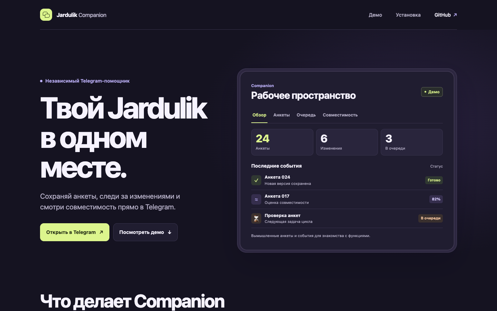
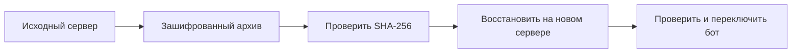

# Jardulik Companion

Независимый помощник для Jardulik в Telegram. Анкеты, избранное, история и уведомления собраны в одном месте.

## 🚀 Выбери способ запуска

| 📲 Готовый сервис | 🖥️ Свой сервер |
| --- | --- |
| **1.** Открой [бота в Telegram](https://t.me/dvachers_jardulik_bot?start=readme) и нажми **Старт** | **1.** Склонируй этот репозиторий |
| **2.** В личном чате подключи свой аккаунт Jardulik | **2.** Скопируй `.env.example` в `.env.local` и задай токен своего бота и ключи |
| **3.** Открой меню и выбери, что автоматизировать | **3.** Запусти `docker compose --profile live up --build -d` |
| [Короткая инструкция пользователя](https://kostia7alania.ru/jardulik-companion/guide.html) | [Чистая установка с Docker или бинарником](docs/installation.md) |

**🎮 Хочешь сначала попробовать?** [Открой демо](https://kostia7alania.ru/jardulik-companion/#demo) или запусти локально `docker compose up --build`. Демо открывается на `http://127.0.0.1:8787`.

## 📦 Перенос между серверами

Переноси целый `.zip.enc` и передавай `BACKUP_KEY` отдельно. В архиве согласованный снимок SQLite, медиа и конфигурация восстановления. [Инструкция по переносу](docs/installation.md#перенос-между-серверами)

## 🧭 Документация

[Swagger UI](https://kostia7alania.ru/jardulik-companion/swagger/) · [OpenAPI JSON](internal/companion/web/swagger/openapi.json)

[Релизы](https://github.com/kostia7alania/jardulik-companion/releases/latest) · [Службы и восстановление](docs/operations.md) · [Сбор и публикация](docs/sync-cycles.md) · [Конфиденциальность](https://kostia7alania.ru/jardulik-companion/privacy.html) · [Условия](https://kostia7alania.ru/jardulik-companion/terms.html)

Исходный код распространяется под [MIT](LICENSE). Сторонние зависимости сохраняют свои лицензии.
