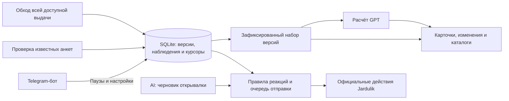
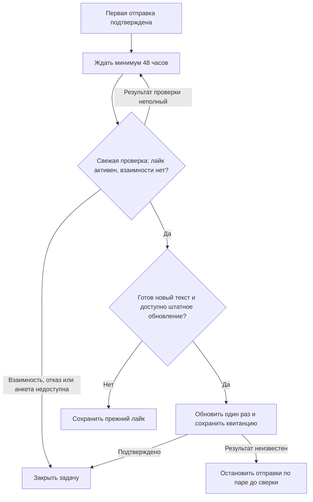

# Сбор анкет и реакции

Действующий порядок и ограничения описаны в [суточном цикле](sync-cycles.md). Этот документ задаёт контракт для реализации и приёмки.

## Независимые процессы

| Процесс | Что делает | Где продолжает после сбоя |
| --- | --- | --- |
| Обход выдачи | Самостоятельно, раз в сутки. Все поддерживаемые возрасты и страницы, доступные этому аккаунту, без личных фильтров. Сохраняет полученное и добавляет новые анкеты в мониторинг. | С последней записанной страницы того же источника. |
| Проверка известных | По своему суточному расписанию проверяет сохранённые анкеты, включая ранее недоступные. Подтверждённая недоступность не удаляет историю. Подтверждённое возвращение создаёт одно событие перехода. | С очередной записи проверки. Свежую подтверждённую проверку из обхода можно переиспользовать для того же аккаунта и поколения сессии. |
| GPT и постер | Забирают зафиксированные версии и события по ID снимка. Публикуют карточки и статусы отдельно от готовности GPT. Принимают поздний расчёт отдельным результатом для его версии. | Со своих очередей и сохранённых квитанций. |

Один активный проход каждого вида на аккаунт. Курсор, наблюдения и обработанные страницы фиксируются одной транзакцией. Текущий снимок публикуемой подборки содержит ID версий и событий, а следующий поиск создаёт свой снимок. Новая версия анкеты не изменяет содержимое уже начатой публикации. Запуск нового сбора не ждёт GPT, Telegram, постер или бэкап и не берёт их сетевые блокировки.

Сборщик запускается отдельной службой с автоматическим перезапуском. Временная ошибка GET оставляет курсор на месте и планирует повтор с возрастающей задержкой. При ограничении запросов соблюдается время ожидания Jardulik. Нужна пауза с явной причиной, когда требуется переподключить сессию, оператор поставил сбор на паузу или БД нельзя записать. После штатного переподключения того же аккаунта сбор возобновляется с совместимого контрольного пункта. При смене аккаунта старый курсор остаётся в истории и создаётся новый проход. Пауза сборщика, пауза постера и выключение реакций управляются раздельно.

У поиска, прямой доступности и свежести разные поля. Пропуск в выдаче учитывается только после полного прохода. Недоступность подтверждается прямым ответом, который Jardulik однозначно определяет как такую. Таймаут, ограничение, истёкшая сессия и частичный проход не меняют последнюю подтверждённую доступность. Если известная анкета раньше не открывалась, проверка идёт по её уже сохранённому ID при наличии штатного доступа у того же аккаунта.

Статус показывает отдельно для обоих проходов последнюю полную проверку, текущий прогресс, ближайшую попытку и причину паузы. Когда проход не уложился в суточное расписание, показывается просрочка даже при живом процессе. У GPT и постера свои счётчики очередей, включая возраст старейшего необработанного задания.

## Выбор реакции

Авторизация сбора и включение реакций независимы. Отправка работает только у владельца, который явно включил свой режим, и только для актуальных доступных взрослых анкет по его фильтрам. При неизвестном или противоречивом возрасте реакция не ставится. Возраст проверяется на дату отправки. Ранее поставленный лайк зачитывается один раз по паре «аккаунт → анкета».

| Анкета подходит под фильтры владельца | Первая реакция |
| --- | --- |
| 18–22 года включительно, есть Огонь и квота | Суперлайк с открывалкой. |
| От 23 лет | Обычный лайк с открывалкой. |
| 18–22 года, Огонь исчерпан | Обычный лайк с открывалкой, если Jardulik разрешает его отдельно. При общем ограничении отправки бот ждёт. |

В реализации это отдельный выбор в настройках авто: «🔥 По возрасту, при 0 Огня ❤️». Запуск авто остаётся отдельным действием. Ноль должен прийти в свежем ответе Jardulik до попытки отправки. Отказ или неизвестный результат уже отправленного запроса не меняет суперлайк на обычный.

Все отправки учитывают подтверждённые квоты и паузы. AI не выбирает получателя, тип реакции или момент отправки. Если готовый текст недоступен, остаётся разрешённый владельцем проверенный шаблон либо ожидание текста.

## Одно обновление через 48 часов

Статус функции: ожидает подтверждения штатной операции Jardulik. Пока доступна первая реакция, а отправленный лайк сохраняется.

Отсчёт идёт от подтверждённой первой отправки. Через 48 часов задача может обновить лайк **один раз на анкету для этого аккаунта**. Отсутствие взаимности не доказывает, что сообщение было прочитано или не понравилось. Поэтому повторный текст использует другой повод начать разговор, без ссылки на молчание получателя.

- Сначала готовится и проверяется новый текст. Перед отправкой проверяются текущая взаимность, наличие своего активного лайка, возраст, доступность, фильтры и квота. Подтверждённый отказ, блокировка, взаимность или ручное снятие лайка закрывают задачу.
- Если Jardulik разрешает штатно заменить текст, используется эта операция. Если разрешены отдельный отзыв своей реакции и повторная отправка, новый **обычный лайк с сообщением** идёт только после подтверждённого отзыва. Старый лайк сохраняется, пока такой сценарий не подтверждён. Возможность обновления обычного лайка и доставка его текста получателю пока не проверены. [Наблюдения о реакциях](telegram-profile-updates.md).
- Отзыв и новая отправка учитываются отдельными шагами с квитанциями. После таймаута или перезапуска с неизвестным результатом сетевые действия по паре приостанавливаются до сверки. Подтверждённый отзыв при неотправленном новом лайке отображается явно. Автоматического третьего касания нет.

## AI-first и приёмка

Модель готовит текст на основе разрешённых полей анкеты и стиля владельца. Для обновления она получает предыдущий текст и выбирает другую подтверждённую зацепку: новый конкретный вопрос вместо пересказа первой открывалки. Сервер проверяет источник зацепки, длину и отличие текста. Модели достаточно передать поля, нужные для текста. Доступа к сессии, спискам взаимностей и отправке у неё нет. Для каждого намерения сохраняются версия политики, выбранная версия анкеты, хеш текста и квитанция действия. [Контракт генератора и проверок](multiuser-opening-generator.md).

Сценарии приёмки запускаются с тестовыми ответами Jardulik, Telegram и управляемыми часами.

| Сценарий | Результат |
| --- | --- |
| GPT недоступен, постер остановлен или Telegram не отвечает при старте | Оба вида сбора продолжаются. Версии и события предыдущего снимка доступны его очередям после восстановления. |
| Запрос страницы оборвался, сборщик перезапущен | Продолжение с сохранённого курсора. Частичный проход не создаёт ложных событий о недоступности. |
| Jardulik вернул ограничение или сессия истекла | До разрешённого срока новых запросов нет. После штатного переподключения того же аккаунта используется совместимый курсор. |
| Ранее недоступная анкета открылась | Записано одно событие возвращения. Повторный одинаковый ответ его не дублирует. |
| Возраст 17, 22, 23 или неизвестен | Пропуск, суперлайк при квоте, обычный лайк с открывалкой, пропуск соответственно. |
| До 48 часов, пришла взаимность, старый лайк отозван владельцем или действие не поддерживается | Нет автоматического отзыва или новой отправки. |
| Через 48 часов взаимности нет, новое сообщение готово, штатное обновление разрешено | Одно обновление с другим текстом. Дубли задач и перезапуск не создают ещё одну отправку. |
| Ответ об отзыве или отправке потерян | Состояние «неизвестно» сохранено. Повторная отправка ждёт подтверждения. |
