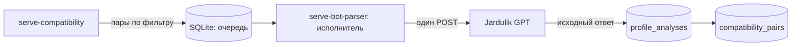

# Расчёт совместимости

Служба `jardulik-companion-compatibility.service` запускает `jardulik serve-compatibility`. Она планирует расчёты для подключённых, неприостановленных аккаунтов по их собственным применённым фильтрам и сохранённым полным анкетам. Новую выдачу или чужие сессии планировщик не запрашивает.

HTTP-выполнение остаётся в `serve-bot-parser`: этот процесс уже владеет общим Jardulik-клиентом и сериализует обновление refresh-токена. Отдельный процесс планирования не запускает Telegram polling, загрузку фото, парсер, постер или debug HTTP. Передача работы идёт через SQLite WAL, новый публичный порт не нужен.



## Хранение

`compatibility_pairs` является отдельной таблицей связей многие ко многим: `owner_id`, `from_user_id`, `target_user_id`. Направления A→B и B→A различаются; права владельцев не объединяются. Одна анкета может участвовать в расчётах разных подключённых аккаунтов.

`compatibility_jobs` хранит очередь и историю попыток для пары и снимков входов. `profile_analyses` сохраняет точные тела запроса, ответа и обоих клиентских снимков, время, статус и сообщённую Jardulik модель. Исходный JSON анкеты расчёт не меняет.

Ключ расчёта `text-v2` включает только `userId`, `name`, `surName`, `birthday`, `age`, `gender`, `country`, `city`, `worldview`, `description`, `profession`, `familyNames`, `children`, `goal`, `height`, `language`, `languages` собственной и целевой анкет. Фото, превью, Premium, балансы и остальные поля его не меняют. Это политика нашего кеша; состав данных, реально используемых моделью Jardulik, сервер не раскрывает.

Готовый результат для тех же входов переиспользуется. При смене версии ключа сервис сравнивает сохранённые исходные анкеты прежних расчётов, поэтому переход на `text-v2` не требует массового повторного POST. Изменение значимого поля создаёт новый расчёт, старый ответ и его входы остаются в истории. Изменение фильтра влияет на допустимость кандидата и само по себе не требует пересчёта прежней пары.

Watcher, суточная проверка, crawler и исполнитель GPT используют общий привязанный к owner/upstream/generation reader `/user/getUser` и сохранение результата. Успешный полный GET сохраняет снимок, доступность и квитанцию наблюдения; в активном суточном цикле он сразу ставит допустимый расчёт в устойчивую очередь. Ошибка постановки не теряет checkpoint: обычный планировщик восстанавливает очередь.

Исполнитель переиспользует полный GET текущего цикла только при точном совпадении аккаунта, поколения и версии анкеты. Иначе он получает профиль тем же reader. Перед GPT собственная анкета из `getMe` переиспользуется до пяти минут по квитанции фактического HTTP, а смена кешированной значимой части собственной анкеты обходит этот TTL. Известно недоступные цели не отправляются в GPT. Ошибка сети, авторизации или несовпадение формата не считаются доказательством отсутствия профиля.

Непосредственно перед POST исполнитель повторно проверяет привязку аккаунта, паузу, актуальный фильтр, версию цели и ключи обоих входов. Команды пользователя имеют приоритет между этапами. После неуспешного расчёта он может отдельно проверить цель прямым GET; подтверждённое отсутствие записывается общим observer. Это не повтор GPT-запроса. Уже начатый POST не повторяется после 401 или сетевого сбоя; незавершённая отправка при перезапуске остаётся с неопределённым результатом. HTTP-ограничения и challenge обрабатываются общим Jardulik-клиентом.

Исходный `content` сохраняется целиком; числовой score не подменяет ответ провайдера. В заголовке и индексе показывается сообщённая Jardulik оценка; если явную итоговую фразу прочитать не удалось, допустим единственный целый процент 0–100 во всём ответе без диапазона, отрицания или противоречия. Этот fallback цитирует число из ответа провайдера и не является нашим новым расчётом совместимости. Исходный ответ сохраняется без изменений; повторный GPT-запрос ради оформления не выполняется. Поле `model` сохраняется как его прислал Jardulik; выбор другой модели этим endpoint не подтверждён.

Новая совместимость публикуется в той же теме после подтверждённой карточки соответствующего снимка и необходимых сообщений об изменениях. При изменении только фото или других исключённых полей прежняя совместимость остаётся в теме, новый одинаковый GPT-пост не создаётся. Общая карточка профиля не содержит персональную оценку владельца.

## Настройка

По умолчанию планирование и выполнение выключены:

```dotenv
COMPATIBILITY_ENABLED=false
COMPATIBILITY_INTERVAL_SECONDS=60
```

Для включения задаётся `COMPATIBILITY_ENABLED=true` в `/etc/jardulik-companion.env`, затем перезапускаются bot-parser и compatibility planner. Интервал является общим минимальным промежутком между автоматическими GPT-запросами, а не обещанием квоты Jardulik. Настройки обычных лайков и их лимит этот воркер не меняет.

Все три runtime-службы используют один опубликованный Go-бинарник. Планировщик ограничен 64 МиБ, `GOMEMLIMIT=32MiB` и одним Go-процессором. Его можно перезапустить отдельно; очередь остаётся в SQLite. `scripts/deploy.sh --no-start` требует остановки bot-parser, poster и compatibility planner и не запускает их самостоятельно. Обычный deploy сохраняет и восстанавливает файлы и состояние всех трёх ролей при ошибке активации.


## Проверка очереди

`jardulik compatibility-status` читает число пар, состояния заданий и общий срок следующей автоматической отправки. `TENANT_ID` выбирает владельца; без него используется основной `OWNER_TELEGRAM_ID`. Эта команда не вызывает GPT.

Последние результаты для владельца и его текущего аккаунта:

```sql
SELECT p.from_user_id, p.target_user_id, a.model, a.observed_at_ms,
       CAST(a.response_body AS TEXT) AS raw_response
FROM compatibility_pairs p
JOIN sessions s ON s.owner_id=p.owner_id AND s.upstream_id=p.from_user_id
JOIN profile_analyses a ON a.id=p.latest_analysis_id AND a.owner_id=p.owner_id
WHERE p.owner_id=:owner_id;
```

История пересчётов остаётся в `compatibility_jobs` и `profile_analyses`. Таблица `compatibility_schedule` хранит курсор планировщика. Все таблицы входят в целую SQLite-копию; новые пары, задания и ответы участвуют в fingerprint ежедневного бэкапа. Само движение курсора не создаёт новый бэкап.
