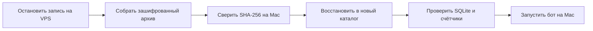

# Установка и перенос

Один бинарник Go содержит веб-интерфейс, Telegram-бота и команды резервного копирования. Для публичной страницы и интерактивного демо не нужны Telegram-сессия, токены и SQLite.

## Установка из релиза

Для Apple Silicon скачайте `jardulik-v0.2.0-darwin-arm64.tar.gz` и `SHA256SUMS` со [страницы релиза](https://github.com/kostia7alania/jardulik-companion/releases/tag/v0.2.0). Проверка и запуск выполняются в каталоге загрузки.

```sh
artifact=jardulik-v0.2.0-darwin-arm64.tar.gz
awk -v name="$artifact" '$2 == name { print }' SHA256SUMS | shasum -a 256 -c - &&
mkdir -p jardulik-bin &&
tar -xzf "$artifact" -C jardulik-bin &&
./jardulik-bin/jardulik serve-web
```

Для Linux используйте файл `linux-amd64` или `linux-arm64` своей архитектуры.

## Локальное демо из исходников

Запустите демо из каталога репозитория на macOS или Linux с Go 1.26.10 или новее.

```sh
go run ./cmd/jardulik serve-web
```

Откройте [http://127.0.0.1:8787](http://127.0.0.1:8787). Compose 2.30 или новее запускает ту же сборку через Docker Desktop на Apple Silicon или Docker Engine на Linux.

```sh
docker compose up --build web
```

Порт на компьютере можно поменять через `JARDULIK_WEB_PORT`. Контейнер доступен на loopback.

## Установка бота

Установите нативный бинарник. Для отправки полных архивов также соберите `telegram-transfer`.

```sh
install -d "$HOME/.local/bin"
GOBIN="$HOME/.local/bin" CGO_ENABLED=0 go install ./cmd/jardulik
(cd tools/telegram-transfer && GOBIN="$HOME/.local/bin" CGO_ENABLED=0 go install .)
```

Создайте файл окружения с правами `0600` вне репозитория по образцу [.env.example](../.env.example). Укажите токен своего бота, идентификаторы владельца и Jardulik, созданные отдельно ключи и путь к приватному каталогу данных. Для нативного запуска задайте `APP_DATA_DIR` на локальном диске и `TELEGRAM_TRANSFER_HELPER` равным абсолютному пути к установленному helper. Запустите `jardulik status` для проверки БД и `jardulik serve` для запуска ролей в одном процессе. Для раздельных Linux-служб и таймера есть [штатный установщик](deployment-transfer.md).

Compose запускает бот только по явной команде. Веб-контейнер и контейнер бота используют один образ. Том с базой подключается к контейнеру бота.

```sh
JARDULIK_ENV_FILE="$HOME/.config/jardulik/runtime.env" docker compose --profile live up --build -d
```

Для Compose пути внутри контейнера устанавливаются автоматически. После запуска Telegram API должен быть доступен с этого хоста. Для публичного домена направьте HTTPS-прокси на веб-порт. Для ежедневного бэкапа добавьте в планировщик хоста команду `docker compose exec -T bot /app/jardulik backup-daily` из каталога установки с тем же Compose-окружением.

## Перенос действующей установки на Mac

Переносимый файл данных называется `*__jardulik-full__*.zip.enc` и обычно лежит в `APP_DATA_DIR/backups/`. Он содержит согласованный снимок SQLite, оригиналы фото, манифест, параметры восстановления и сессию транспорта при её наличии. `BACKUP_KEY` хранится отдельно. Исходный `SESSION_KEY` нужен на новой установке для чтения сохранённых сессий.



1. На VPS зафиксируйте версию и статус. Для согласованного переключения остановите бота, постер, планировщик и таймер резервного копирования. Если включён отдельный Mini App, тоже остановите его запись. Соберите локальную копию через `jardulik backup-full` с тем же файлом окружения. Сохраните `encrypted_sha256` и путь из результата.
2. Передайте весь `.zip.enc` через защищённое соединение, например `scp`. Сверьте SHA-256 файла с сохранённым значением командой `shasum -a 256`. Задайте прежний `BACKUP_KEY` через приватное окружение и выполните `jardulik restore /путь/к/копии.zip.enc /новый/каталог`. Распакованные `recovery-config.json` и SQLite храните приватно.
3. Настройте окружение Mac. Задайте `APP_DATA_DIR` на восстановленный каталог, проверьте `SESSION_KEY` и перенесите нужные настройки через приватный файл окружения. Если в старом окружении указан `TELEGRAM_TRANSFER_SESSION_FILE`, обновите путь внутри нового каталога. Запустите `jardulik status` локально и проверьте `"sqlite":"ok"` и счётчики. Этот вывод может содержать сведения об аккаунте.
4. Запустите один экземпляр с рабочим токеном и проверьте ответ на `/start`, подключение Jardulik и фоновые очереди. Для работы после выхода из терминала запуск на macOS можно оформить через `launchd` или профиль `live` в Docker Compose. VPS оставьте остановленным до приёмки. Если после запуска Mac уже менял данные или публиковал в Telegram, перед откатом сначала остановите Mac и перенесите актуальное состояние обратно.

Для репетиции используйте искусственный архив и отдельные ключи. Распакованные данные временно занимают место сверх размера зашифрованной копии. Для полной процедуры восстановления см. [описание бэкапа](../README.md#полный-бэкап-v2).
