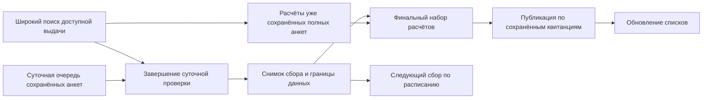

# Суточный цикл

Здесь описана реализация. Правила реакций и критерии приёмки описаны в [Сбор анкет и реакции](collection-and-reaction-policy.md).

Поиск и проверка сохранённых анкет могут начинаться до готовности Telegram. Ранняя ошибка планирования GPT записывается в журнал и не прерывает сохранение данных. После фиксации собранных данных следующий суточный сбор может стартовать по расписанию, пока предыдущий цикл обрабатывает GPT или публикацию.

`SYNC_CYCLE_ENABLED=true` включает сохранённый цикл для каждого подключённого неприостановленного аккаунта. При выключенном `COMPATIBILITY_ENABLED` цикл пропускает расчёты GPT. В первой выкладке `COMPATIBILITY_INTERVAL_SECONDS=10` выбран владельцем. Настройки личного поиска и автолайков не меняются.

Поиск использует диапазон 0–111, обычную и расширенную выдачу, каталог Locations и последовательное получение полных анкет. Сервер определяет доступную выдачу для подключённого аккаунта. Начальный цикл принимает подходящий незавершённый или свежий завершённый обход текущего аккаунта и сохраняет его курсор.

Поиск и суточная очередь сохранённых анкет продвигаются независимо. Если оба готовы, внутренний планировщик чередует шаги. После шага действует общая пауза не менее 20 секунд. Сохранённые анкеты, включая ранее недоступные, проверяются и при остановленном поиске. `/status` и операционный тред показывают прогресс проверки отдельно. Очередь сохраняет время следующей попытки. Если процесс завершился во время чтения, проверка снова доступна после минутного срока резерва.

Таймаут или обрыв известного GET и HTTP 500, 502, 503 и 504 сохраняют страницу или цель проверки. Суточный поиск повторяет попытку через минуту, затем через пять минут, затем раз в час. Если Jardulik указал большее время ожидания, используется оно. Пауза сессии, непроверенный тип ошибки и ошибки сохранения по-прежнему требуют разбирательства.

Проверка состояний имеет фиксированный набор целей. Общий reader `/user/getUser` сохраняет точную анкету, доступность и время наблюдения с проверкой текущего owner/upstream/generation. Подтверждённые полные GET этого цикла переиспользуются только для той же версии и привязки источника. Завершённый широкий поиск ведёт отдельное состояние выдачи. Первый пропуск создаёт уведомление, если прямая проверка ещё не подтвердила, что анкета недоступна. Запись о пропуске сохраняется для определения возврата в следующем завершённом проходе. При обновлении состояние выдачи восстанавливается из последнего завершённого прохода, квитанции прежних сообщений сохраняются.

После успешного полного GET допустимая цель сразу попадает в устойчивую очередь GPT, без второго target GET. Сбой enqueue не отменяет сохранение refresh checkpoint: планировщик восстанавливает очередь. Если профиль исчез между GET и GPT, неуспешный расчёт может вызвать прямую проверку тем же reader; подтверждённое отсутствие записывается общим observer, оплачиваемый POST не повторяется.

Расчёты взрослого архива идут параллельно сбору и проверке, без личных фильтров возраста18..25, роста и остальных предпочтений. Финальный frontier ограничен когортой проверки, поэтому новые foreground-запросы не делают цикл бесконечным. Готовые ответы на неизменившиеся значимые поля переиспользуются по `text-v2`, в том числе из прежних сохранённых входов. Фото, превью, Premium и счётчики не инвалидируют расчёт. Неопределённые отправки не повторяются автоматически и учитываются отдельным итогом.

Постер получает frozen manifest версий, расчётов и событий. Постер выбирает самый ранний готовый к публикации цикл. Версии анкет и события ограничены границами его снимка. Сетевые отправки сохраняют файловую блокировку между процессами. Обычный старт нового сбора от неё не зависит. SQL-транзакция не держится во время HTTP. Новые фоновые сообщения ждут стадии публикации. Отдельная миграция оформления может редактировать уже подтверждённые message IDs по неизменным исходным снимкам во время сбора; она не создаёт карточки или новые сообщения и сохраняет дату исходной публикации. Пауза пользователя, blocked-состояние или смена привязки источника откладывают такую правку. Личные команды и отдельный тред аудита открывашек продолжают работать.

В теме сначала подтверждается карточка сохранённой версии и необходимые сообщения об изменениях, затем публикуется новый GPT-ответ. При неизменившихся значимых входах прежний расчёт сохраняется без повторного поста.

Telegram принимает правки последовательно с общим pacing, поэтому весь форум не меняется атомарно. Завершение определяется подтверждёнными message IDs, layout, source hashes и frozen index hashes, а не пустой глобальной очередью. Поздние события доступности не расширяют manifest: конфликтующие старые notices получают объяснимый disposition, outbox сохраняется.

`jardulik sync-status` читает локальное состояние без HTTP. `/status` показывает стадию и число готовых расчётов. Source switch, ручная пауза или неполный обход блокируют продвижение; блокировка не выдаётся за успешно завершённый проход.

После повторного подключения того же аккаунта цикл с замороженным манифестом и причиной `source_binding_or_pause_changed` может уступить место новому циклу. Для этого нужны новое поколение подключённой сессии, отсутствие пауз и наступление `next_cycle_ms` (24 часа от начала прежнего поиска). Старый цикл получает статус `superseded` с исходной причиной. Его манифест, результаты и квитанции сохраняются. Новый поиск использует своё поколение и отдельный курсор. Блокировки до подготовки публикации остаются в `blocked` до проверки причины.

Если широкий поиск остановился на первом запросе аккаунта с `auth_required`, оператор может вызвать `jardulik sync-recover-auth <cycle-id> <crawl-run-id> <operations-event-id>`. Команда требует сохранённую ошибку HTTP 400 из журнала, успешное переподключение того же аккаунта после остановки, пустой курсор первой страницы и отсутствие пауз. Она сохраняет исходный цикл с его причиной и снимок остановленного обхода. Новый поиск начинается с первой страницы и учитывает уже записанный интервал запросов. Запись истории, замена задания и создание цикла фиксируются одной транзакцией.

Для старой остановки `request_failed` доступна команда `jardulik sync-resume-crawl <cycle-id> <crawl-run-id> <operations-event-id>`. Она возобновляет только текущий незавершённый проход той же подключённой сессии, если в журнале сохранилась соответствующая ошибка чтения без HTTP-статуса. Команда сохраняет курсор, результаты и интервал следующего запроса. Одна запись восстановления фиксируется вместе с возвратом обхода в расписание.

После появления записи `superseded` планировщику нужна версия, которая понимает этот статус. Предыдущая версия планировщика считает такую запись активной и после завершения нового цикла не сможет запустить следующий.

Бэкап содержит всю SQLite, включая курсоры и manifest. Его fingerprint не меняется только из-за read-only обхода, часов или движения cursor. Подтверждённые и неопределённые новые отправки аудита открывашек, реальные исходные данные и устойчивое blocked-состояние учитываются как изменения.
